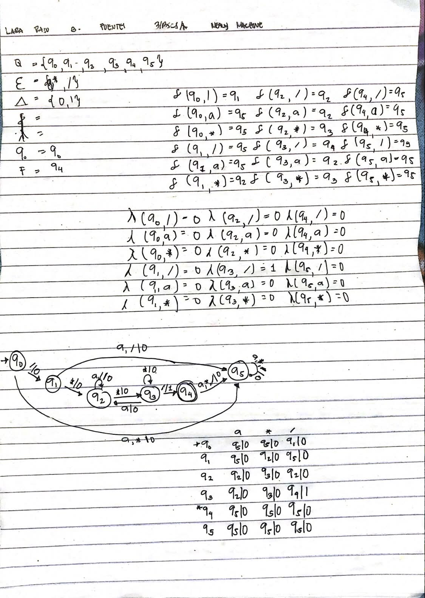
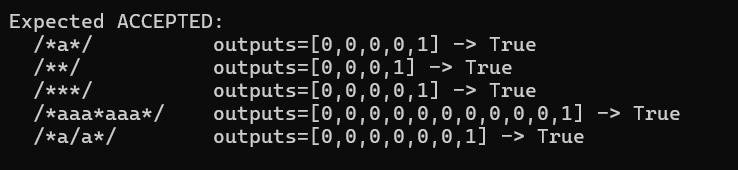
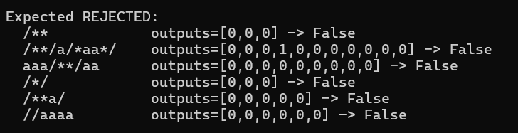

# Mealy Machine for C-Style Comments

A Mealy machine in C# that recognizes C-style comments (`/* ... */`) over the alphabet {a, *, /}, where `a` stands for any character that is not `*` or `/`.

## Rules

- The comment starts with `/*` and ends with the first `*/`.
- `/*` and `*/` cannot overlap, so `/*/` is invalid.
- Nothing may appear after the closing `*/`.

## Formal Definition

M = (Q, Σ, Δ, δ, λ, q0, F)

- **Q** = {q0, q1, q2, q3, q4, q5}
- **Σ** = {a, *, /}
- **Δ** = {0, 1}
- **δ**: transition function (next state)
- **λ**: output function
- **q0**: start state
- **F** = {q4}: end state

A string is **accepted if the last output is 1**. The output is 1 only when the closing `/` of `*/` is read.

## States

| State | Meaning |
|---|---|
| q0 | Start |
| q1 | Read the opening `/` |
| q2 | Inside the comment |
| q3 | Inside the comment, just read a `*` |
| q4 | Comment closed (end state) |
| q5 | Trap state (invalid string or extra characters) |

## Transition Table (next state | output)

| State | `a` | `*` | `/` |
|---|---|---|---|
| → q0 | q5 \| 0 | q5 \| 0 | q1 \| 0 |
| q1 | q5 \| 0 | q2 \| 0 | q5 \| 0 |
| q2 | q2 \| 0 | q3 \| 0 | q2 \| 0 |
| q3 | q2 \| 0 | q3 \| 0 | **q4 \| 1** |
| **q4 (end)** | q5 \| 0 | q5 \| 0 | q5 \| 0 |
| q5 (trap) | q5 \| 0 | q5 \| 0 | q5 \| 0 |

## Diagram

Edge labels are `input | output`.

## Test Results

### Accepted

### Rejected

## Notes

A Mealy machine does not need an end state because acceptance comes from the output. State q4 only shows where the comment ends and does not change which strings are accepted.
